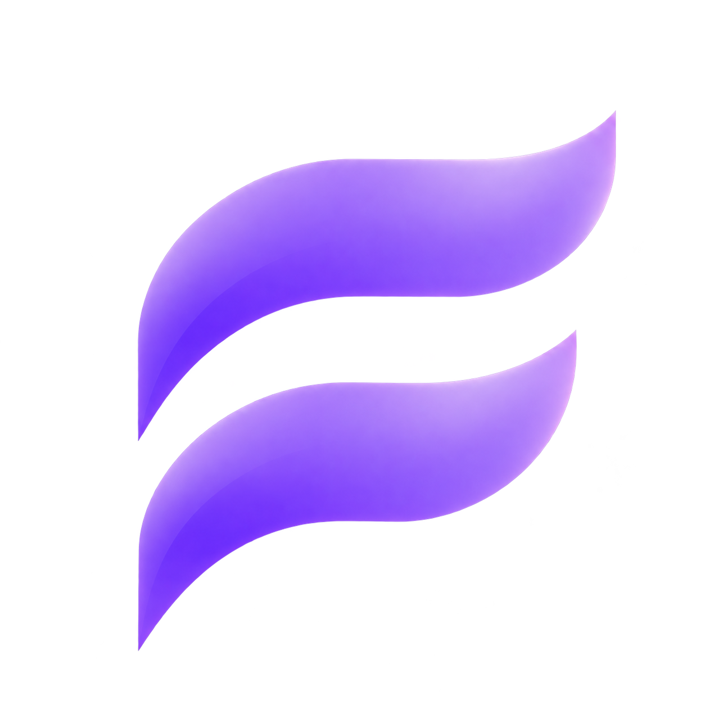
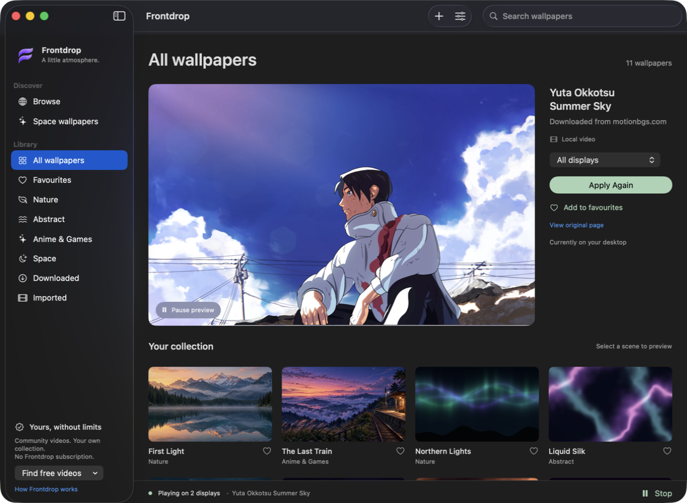
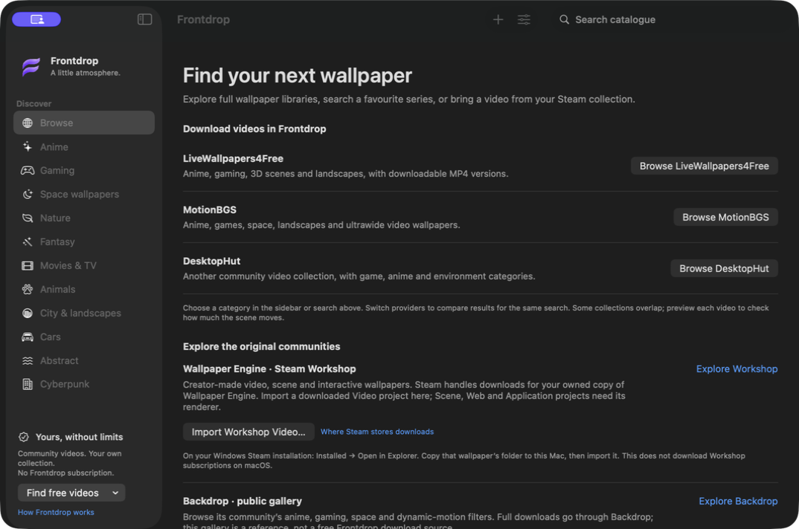
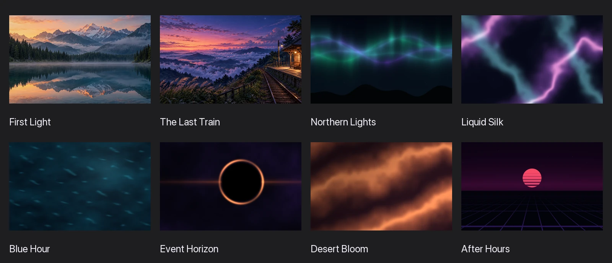

<p align="center">
  
</p>

<h1 align="center">Frontdrop</h1>
<p align="center"><strong>A little atmosphere for your Mac.</strong></p>
<p align="center">Native animated wallpapers. Original scenes, community videos, and your own collection.<br>No Frontdrop account, subscription, watermark, or analytics.</p>
<p align="center"><a href="#build-and-run">Build &amp; run</a> · <a href="#make-it-yours">Features</a> · <a href="#built-in-scenes">Scenes</a> · <a href="#scope-and-compatibility">Compatibility</a></p>



Frontdrop puts muted, looping video and original Metal animations behind your desktop icons. Pick a scene, preview it, and click **Set Wallpaper**. Stop or quit to reveal your existing macOS wallpaper; your saved system wallpaper stays intact.

## Build and run

Requires **macOS 14+** and Apple's command-line developer tools with a **Swift 6 toolchain**. The recorded runtime checks were on Apple silicon with macOS 26.6.2; older macOS versions have not been runtime-tested. Frontdrop uses Apple frameworks with no third-party package dependencies.

```sh
git clone https://github.com/GenQu4rk/Frontdrop.git
cd Frontdrop
./scripts/build.sh
open dist/Frontdrop.app
```

If the developer tools are missing, install them with `xcode-select --install` first. The build script packages and ad-hoc signs `dist/Frontdrop.app`; it does not create a notarized release. You can copy the built app to your Applications folder.

`Package.swift` supports source navigation and package-based builds. Use `scripts/build.sh` for the packaged macOS app. To choose a specific SDK, set `FRONTDROP_SDK_PATH` when running the script.

## Make it yours

- **Start with eight original scenes.** Abstract colour, alpine mist, northern lights, a quiet railway, and space. Bundled scenes work offline.
- **Bring your own videos.** Import MP4, MOV, M4V, and other AVFoundation-playable files. Frontdrop copies imports into its managed library so moving the original does not break playback.
- **Find community wallpapers.** Browse LiveWallpapers4Free, MotionBGS, and DesktopHut inside the app. Eleven subject collections, provider switching, title search, and pagination help you explore. Supported downloads are validated and added to **Downloaded** with their source link.
- **Import Workshop Video projects.** Choose a downloaded Wallpaper Engine **Video** project folder. Frontdrop reads its `project.json`, imports the actual video, and keeps the title and source attribution.
- **Choose your framing and displays.** Keep every edge with **Fit whole video**, or crop to cover with **Fill screen**. Apply to all displays, the main display, or one selected display. Framing is saved per video.
- **Keep favourites in rotation.** Save a collection and enable rotation in Settings. When favourites exist, rotation uses them.
- **Control playback from the menu bar.** Pause, resume, switch scenes, stop, or reopen the library. Closing the window keeps the wallpaper running and hides the Dock icon; reopening restores the library's browsing state.
- **Set your playback preferences.** Choose 24, 30, or 60 fps for procedural scenes, configure battery/Low Power/fullscreen pause preferences, and optionally enable Start at Login. Videos play at their source frame rate.

<details>
<summary><strong>Inside the wallpaper browser</strong></summary>



**Block ads** is on by default in Browse. Turn it off if a provider page needs an exception. Provider branding, consent choices, and asset terms remain visible. If a site's download flow changes, use **Open in Browser**, then **Import Video**.

Supported ZIP downloads are imported automatically when they contain exactly one supported video. Archive contents are never installed or run. Steam Workshop and Backdrop's public gallery are external community references; Frontdrop does not download Steam subscriptions or access Backdrop's community service.

Browse requires internet. Downloaded videos and original scenes play offline. Wallpaper rights remain with their creators; follow each source's terms. See [wallpaper sources and integration limits](docs/WallpaperSources.md).

</details>

## Built-in scenes



| Nature | Abstract | Anime & games | Space |
| --- | --- | --- | --- |
| First Light | Liquid Silk | The Last Train | Event Horizon |
| Northern Lights | Desert Bloom | After Hours | |
| Blue Hour | | | |

Six scenes are fully procedural. First Light and The Last Train animate original generated backgrounds with shader effects. The gallery uses still frames rendered by Frontdrop's production Metal pipeline. See [artwork provenance](docs/Artwork.md).

## How it works

A SwiftUI library controls noninteractive AppKit windows above the desktop background and below its icons. Each selected display hosts either a Metal scene or a muted AVFoundation video loop. Stopping playback removes those windows.

Your library defaults to `~/Library/Application Support/Frontdrop/`. Settings shows the active path. An externally configured library is bound to its drive's volume UUID; if it is unavailable, imports and downloads ask you to reconnect it instead of silently creating a replacement library.

## Verify a build

```sh
# Playback policies, catalogue rules, window lifecycle, ad blocking,
# Workshop manifests, ZIP handling, and storage checks
./scripts/test.sh

# Real video import, looping, persistence, and preview behaviour
./scripts/integration-test.sh /path/to/a/short-video.mp4

# Render all eight scenes through the production Metal pipeline
./dist/Frontdrop.app/Contents/MacOS/Frontdrop \
  --render-previews --output "$PWD/docs/previews"

codesign --verify --deep --strict --verbose=2 dist/Frontdrop.app
```

The standalone Swift test harnesses do not require a full Xcode/XCTest installation. The [verification record](docs/Verification.md) documents past checks and their limits.

## Scope and compatibility

- **Desktop animation only.** Animated Lock Screens, interactive/web/audio-reactive wallpapers, and Wallpaper Engine Scene/Web/Application projects are unsupported.
- **One scene across selected displays.** Different simultaneous scenes per monitor are not implemented. A disconnected target falls back to the main display.
- **System codecs determine video support.** A file extension alone does not guarantee playback. Provider pages and download flows can change.
- **Energy use varies.** Scene, frame rate, resolution, and display count affect power consumption; no energy benchmark is claimed. Procedural scenes render at up to 1920 pixels wide.

Frontdrop is an independent implementation and does not require Backdrop. The [research evidence](docs/Evidence.md) records the original investigation and its explicit unknowns.

## Licence

[MIT](LICENSE) for Frontdrop source and original shader code. Original generated scenic assets are included for use with Frontdrop. Imported third-party videos retain their original rights. No Cindori binary, source code, branding, or wallpaper assets are bundled with the app.
