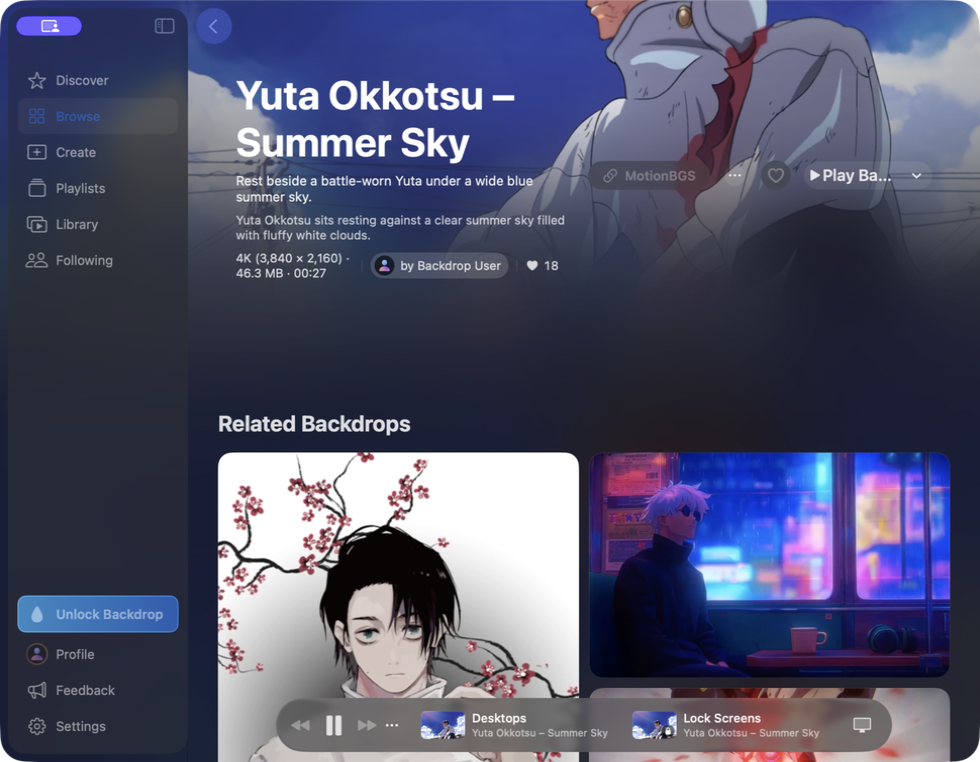

# Backdrop: what the evidence shows

Inspected on 19 October 2026 using the newly installed **REA 6.7.0**, plus read-only inspection of bundled resources and a passive capture of the running app. Frontdrop is an independent implementation of the desktop wallpaper experience.

## The observed app

REA captured the existing Backdrop window, not a mockup. The visible scene is **Yuta Okkotsu – Summer Sky**, with **3840 × 2160**, **46.3 MB**, and **00:27** shown in its UI. The screenshot shows a MotionBGS source credit and separate Desktop and Lock Screen controls. The capture does not establish that playback, downloads, or Lock Screen changes succeeded.

Evidence: `ev_2b5c7ab0d00480ac88d210da7574d891c62808d41e202470e50ec1d464c4689f`, [complete UI record](evidence/backdrop-ui-rea.json).

## Findings and their limits

| Finding | Concrete evidence | What it establishes |
| --- | --- | --- |
| Native Mac app, version 2.10.2 (143) | REA parsed `com.cindori.Backdrop`, executable `Backdrop`, minimum macOS 15.0 from Info.plist | Identity and declared compatibility, not runtime correctness |
| Apple video playback and looping APIs | Mach-O imports include `AVPlayer`, `AVPlayerItem`, `AVPlayerLayer`, `AVPlayerLooper`, `AVPlayerView` | These APIs are linked; the exact live playback path remains untraced |
| Video reading and encoding | Imports include `AVAssetReader`, `AVAssetWriter`, `VTCompressionSessionCreate`, `VTCompressionSessionEncodeFrame` | Video-processing facilities are present; codec settings and actual hardware acceleration were not measured |
| Wallpapers can be ordinary videos with metadata | Bundled Dancing Petals manifest declares `type: video`, duration 5.1 seconds, 3300 × 2160, and named MOV asset/preview files | The format of this bundled scene; not a complete specification of every scene type |
| CloudKit and a local model | CloudKit/CoreData dependencies, `CKContainer` imports, bundled `.momd` models; vendor says community access requires iCloud | Consistent with a cloud catalogue and local library. Network/database operations were not traced |
| Separate wallpaper agent and renderer | LaunchAgent plists reference `BackdropWallpaper.app`, `--wallpaper-agent`, `--wallpaper-renderer`, and named Mach services | Declared helper architecture; service registration and message flow were not observed |
| Renderer uses Apple video and surface facilities | Renderer binary imports `AVPlayerLayer`, `AVPlayerLooper`, `IOSurfaceCreateXPCObject`, `IOSurfaceLookupFromXPCObject`, `IOSurface` | Consistent with surface transport between processes; it does not establish the complete rendering pipeline |
| Desktop/Lock Screen are separate destinations | Running UI shows both; bundled text mentions aerial catalogue setup and wallpaper reconciliation | Lock Screen support exists in the product, but its implementation has not been recovered or reproduced |

The key distinction is between the **wallpaper player** and the **catalogue of artwork**. We can independently implement a local player and create original scenes. Reusing Backdrop's paid community service is not necessary to play your own MP4/MOV wallpapers.

## REA provenance

- [Connected REA server identity](evidence/rea-server.json): package/server 6.7.0, 207 tools, skill version 42.
- [Main-app records](evidence/backdrop-rea.json): plist, Mach-O imports/dependencies, renderer LaunchAgent.
- Main executable SHA-256: `4b4f25c63b4abbd0ea8b12e387d45109132154f5499f23064940305aa6eeb81a`.
- Main Mach-O evidence: `ev_5ea2827fb447e74ed5d469c6d60976b4a1dc272a98127274a8d7da28cb738b11`.
- Info.plist evidence: `ev_19a1efd0c40e331f57104f591d6cbc6fabdcbc17c86e404f96f3e4587527e38e`.
- Renderer LaunchAgent evidence: `ev_517f021c432425d15c2de325223efb0d6cbe8c7be4526d5f9e22c8371af10049`.
- [Renderer records](evidence/renderer-rea.json): executable SHA-256 `9d2cb6b10d910aa35727ff2561e0d637cc2c6a8a966a152a78abb0efa506722d`; Mach-O evidence `ev_2a4863010ce67b97c1082f654c9da9fd00008caa6a128a202c526ee436b57ccc`.
- [Resource observations](evidence/resource-observations.json): direct file reads, original paths, hashes and parsed data. These are shell observations, not REA Evidence records.

REA's native inspection is usable, but no Ghidra, Hopper, IDA or Kuna engine is configured in this session. **No decompilation, complete control-flow recovery, or live native-call trace is claimed.** REA notes that stripped/toolchain-hidden imports may be absent, so the import inventory cannot prove that an API is unused.

## What Frontdrop builds

Frontdrop uses a simpler independent architecture: a local SwiftUI library controls noninteractive AppKit windows positioned just above the desktop background and below desktop icons. Each display hosts either an original Metal animation or a muted, looping AVFoundation video. Stopping or quitting removes these windows, revealing the existing macOS wallpaper.

Eight bundled scenes cover abstract, nature, and anime/game-inspired themes. Two original generated backgrounds receive animated camera drift, water/fog, or floating lights; six scenes are fully procedural. See [artwork provenance and exact prompts](Artwork.md). Local video import copies files into Application Support so moving the original does not break playback. No account, network service, watermark or subscription is needed.

Frontdrop includes favourites, rotation, display targeting, optional login launch, and pause policies. **Animated Lock Screen support, Backdrop's community catalogue, interactive/audio-reactive scenes, and different simultaneous scenes per monitor are not implemented.** No claim of matching Backdrop's energy use is made. Actual power consumption depends on scene, resolution, frame rate and display count.

## Public corroboration

[Cindori's product page](https://cindori.com/backdrop) describes video scenes, multi-display playback, playlists, custom-video import, iCloud community access, Lock Screen support, and trial restrictions. These are vendor claims, distinct from the local observations above. Its CPU figure is vendor-measured and has not been reproduced here.

[MotionBGS](https://motionbgs.com/) offers free downloads across anime, games and nature; [Pexels nature videos](https://www.pexels.com/search/videos/nature/) offers free stock footage. Frontdrop now embeds the live [MotionBGS](https://motionbgs.com/) and [DesktopHut](https://www.desktophut.com/) pages in Browse, including a dedicated [Space collection](https://motionbgs.com/tag:space/). Supported video downloads are validated and imported directly, retaining the original page link. Pexels remains an external link with manual import. Frontdrop does not mirror provider catalogues or access Backdrop’s service. Use downloaded assets according to their source terms.

## Native catalogue follow-up

A focused REA reinspection of the same Backdrop executable confirmed imports for CKDatabase record queries (including pagination via CKQueryCursor), CKRecord, CKAsset, CKContainer, NSPersistentContainer and NSManagedObjectContext, plus CloudKit, CoreData and SwiftUI dependencies. Complete fresh export: `evidence/backdrop-catalogue-rea.json`. These are linked capabilities, not a live request trace.

The bundled Core Data model `Backdrop.momd/BDCollectionsV2.mom` was decoded using Apple’s NSManagedObjectModel, without opening any user database. Its entities include Catalog, CatalogPage, ShelfSection, CollectionSnapshot, Backdrop, Submission and User. Catalog relates to pages and collections; pages have sections. CollectionSnapshot stores wallpaper IDs, thumbnail IDs, description and artworkSourceID. Backdrop stores title, category, tags, keywords, colours, dimensions, duration, file size, checksums, submissionID, recordID and source link fields. Retained schema: `evidence/backdrop-catalogue-model.json` (direct resource observation, not REA).

Together with the bundled scene manifest and visible source credit, this supports a data-driven native catalogue with local persistence and separately managed artwork assets. Cindori’s current product page describes user submissions, curated collections and iCloud-required community access. Exact cloud record types, remote hosting locations, media download flow, ingestion methods, rights agreements and source-provider partnerships have not been established. No conclusion that Backdrop scrapes MotionBGS, or has specific permission from MotionBGS, follows from the displayed source link alone.
